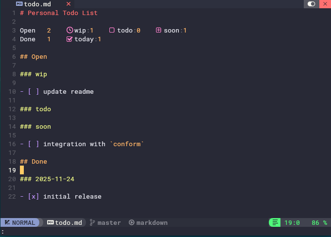

# nvim-todo

A simple Neovim plugin to manage todo lists in markdown files.



## Features

- Formatting and reordering of tasks into structured sections (Open/Done with states)
- Real-time summary with virtual text showing task counts and icons at section headers
- Automatic detection of todo list format on open

## Usage

1. Open a markdown file containing todo tasks in `- [ ]` format.
2. Run `:TodoFormat` to format and reorder the tasks into structured sections.
3. Virtual text will appear below H1 header, displaying task counts with icons.
4. The summary updates automatically as you edit the file.

## Installation

Install using [lazy.nvim](https://github.com/folke/lazy.nvim):

```lua
return {
  "aanatoly/nvim-todo",
  cmd = { "TodoFormat" },
  ft = { "markdown" },
  keys = {
    {
      "<leader>ft",
      function()
        vim.cmd "TodoFormat"
      end,
      desc = "Todo Format",
    },
  },
  opts = {}, -- see configuration below
}
```

## Requirements

- [nvim-treesitter](https://github.com/nvim-treesitter/nvim-treesitter) with markdown parser installed

## Configuration

You can customize the plugin by passing options in lazy or
calling `require("todo").setup(opts)`.

Default options are:

```lua
opts = {
  title = "Personal Todo List", -- Default H1 header
  open = {
    name = "Open", -- Name for open tasks section
    icon = " ", -- Icon for open tasks
    default = "todo", -- Default state for open tasks
    states = {
      { name = "wip", icon = " " },
      { name = "todo", icon = " " },
      { name = "soon", icon = " " },
    },
  },
  done = {
    name = "Done", -- Name for done tasks section
    icon = " ", -- Icon for done tasks
    states = {
      { name = "today", icon = " " },
    },
  },
}
```
